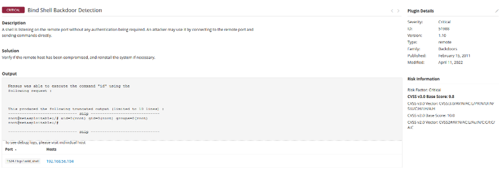

# FND-002: Unauthenticated Bind Shell with Root-Level Command Execution

## Assessment context

- Environment: Metasploitable 2, deliberately vulnerable Linux training VM
- Scanner: Tenable Nessus Essentials (unauthenticated network scan)
- Target: `192.168.56.104` on an isolated VirtualBox Host-Only network
- Affected service: bind shell, `1524/TCP`
- Source: Nessus plugin details and scanner output supplied from the local lab
- Relationship to Project #3: Separate hands-on lab extension; **not** an observed finding at fictional Pine Ridge Logistics, Inc.

## Identification and severity

- Nessus finding: **Bind Shell Backdoor Detection**
- Nessus Plugin ID: **51988**
- Scanner severity: **Critical**
- CVSS v3.0 base score: **9.8** (Nessus-reported)
- CVSS v2.0 base score: **10.0** (Nessus-reported)
- Verification: **Scanner-confirmed unauthenticated command execution**

## Evidence and interpretation

Nessus reported that a shell was listening on the remote service without authentication. The plugin successfully issued the non-destructive `id` command and obtained output identifying a **root** user context, including `uid=0(root)`, `gid=0(root)` and `groups=0(root)`.

This is evidence of **root-level command execution via the exposed bind shell** on the deliberately vulnerable lab VM. It is not merely an inference from an open port.

Nessus performed the validation. The student did **not** independently execute a manual exploitation sequence, obtain persistence, or access any third-party system. The screenshot supports the scanner's reported result, but it does not establish the origin or history of the backdoor.

## Security impact

An unauthenticated remote shell executing with root privileges could allow an attacker who can reach the port to run arbitrary system commands, access or alter data, and disrupt the system. In this lab, exposure was limited to the configured Host-Only network. Business impact in a production setting would depend on connectivity, asset role, privileges and other controls.

## Recommended remediation and validation

1. **For a real affected system:** isolate the host and follow incident-response procedures; investigate the source of the backdoor and assess whether reimaging from a trusted baseline is required.
2. Remove the unauthorized listener and address the underlying compromise; review other services and potential persistence mechanisms.
3. Restrict management access and block unnecessary inbound connections through network and host firewalls.
4. Rebuild or restore from known-good media as appropriate, rotate any potentially compromised credentials, and investigate related assets.
5. Perform a follow-up scan and verify that `1524/TCP` is no longer exposed and the Nessus bind-shell check no longer succeeds.

**Training-lab note:** Do not assume remediation was performed. Metasploitable 2 is designed to remain vulnerable for authorized practice; preserve isolation and use a separate hardened comparison machine if testing fixes.

## NIST CSF 2.0 category alignment (analyst interpretation)

- `PR.PS` — Platform Security: secure platform configurations and reduction of unauthorized services.
- `PR.IR` — Technology Infrastructure Resilience: isolation and protections that limit the effect of compromise.
- `DE.CM` — Continuous Monitoring: detecting suspicious exposed services and activity.
- `RS.MI` — Incident Mitigation: containment and removal of malicious access paths.

These are category-level analytical mappings for this lab, **not proof of compliance** or independently tested CSF outcomes.

## Status and limitations

- Finding status: **Scanner-confirmed in lab**
- Remediation status: **Not implemented / not verified**
- Rescan status: **Not performed**
- Authentication: **Unauthenticated Nessus scan**
- Scope: **Only the Metasploitable 2 training VM**
- No claim of a real enterprise breach, incident attribution, or production compromise
