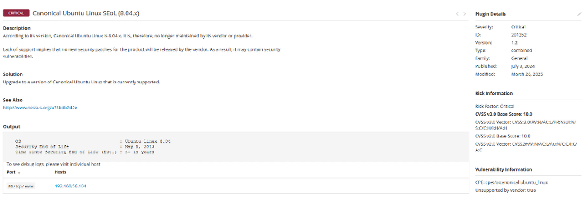

# FND-004: Canonical Ubuntu Linux Security End of Life (8.04.x)

## Assessment Context

- Environment: Isolated Metasploitable 2 training VM in VirtualBox Host-Only network
- Assessment tool: Tenable Nessus Essentials
- Assessment method: Unauthenticated network vulnerability scan
- Target host: `192.168.56.104`
- Service/port reported by Nessus: `80/tcp` (`www`)
- Scope: Controlled lab only; not Pine Ridge Logistics infrastructure

## Nessus Finding Metadata

- Plugin title: **Canonical Ubuntu Linux SEoL (8.04.x)**
- Plugin ID: **201352**
- Reported severity: **Critical**
- Reported CVSS v3.0 base score: **10.0**
- Plugin family: General
- Nessus CPE: `cpe:/o:canonical:ubuntu_linux`
- Specific CVE: **Not identified by this end-of-life finding**

## Technical Evidence

Nessus plugin output reported:

```text
OS                            : Ubuntu Linux 8.04
Security End Of Life          : May 9, 2013
```

The scan associated this result with target `192.168.56.104` on `80/tcp`.
Nessus also indicated `Unsupported by vendor: true`.

The attached screenshot preserves the finding's description, solution, plugin metadata,
scan output, and affected host/port.



## Analysis and Business Impact

Nessus identified an operating-system release that has passed the vendor's security
support period. An unsupported platform may no longer receive routine vendor security
patches, increasing exposure to newly discovered vulnerabilities and creating
operational and compliance concerns.

**Evidence boundary:** This is a scanner-detected software lifecycle finding, not a
verified exploit or proof that a particular CVE exists on the host. Operating-system
identification was not independently validated with a credentialed check. The Nessus
CVSS score belongs to the plugin's classification; it is not an independently
calculated enterprise risk score.

## Recommended Remediation

1. Confirm the OS distribution and release locally or through approved authenticated inventory.
2. Replace or upgrade the unsupported OS to a currently supported platform using a
   documented migration and compatibility plan.
3. Back up required data and configurations before migration; verify service compatibility.
4. Until migration, isolate the legacy host, restrict exposed services and management
   access, and track the exception with an owner and deadline.
5. Rescan after migration and validate the supported OS version and service exposure.

**Lab exception:** Metasploitable 2 is intentionally obsolete for security training.
Do not upgrade it merely to remove its built-in vulnerabilities. In an enterprise
setting, a comparable unsupported production system would need risk treatment.

## Framework Mapping

- **NIST CSF 2.0 PR.PS — Platform Security:** maintenance and security of software/platforms
- **NIST CSF 2.0 ID.AM — Asset Management:** technology inventory and lifecycle awareness
- **NIST CSF 2.0 ID.RA — Risk Assessment:** analysis of exposure associated with unsupported software

These mappings are analyst interpretations for the training assessment, not evidence
that the fictional enterprise achieved or failed any CSF outcome.

## Status and Limitations

- Detection status: Reported by Nessus, with plugin output captured
- Independent OS verification: Not performed
- Exploitation: Not attempted
- Remediation: Not implemented — deliberately vulnerable lab target
- Post-remediation rescan: Not performed
- Real-world enterprise findings: None claimed
